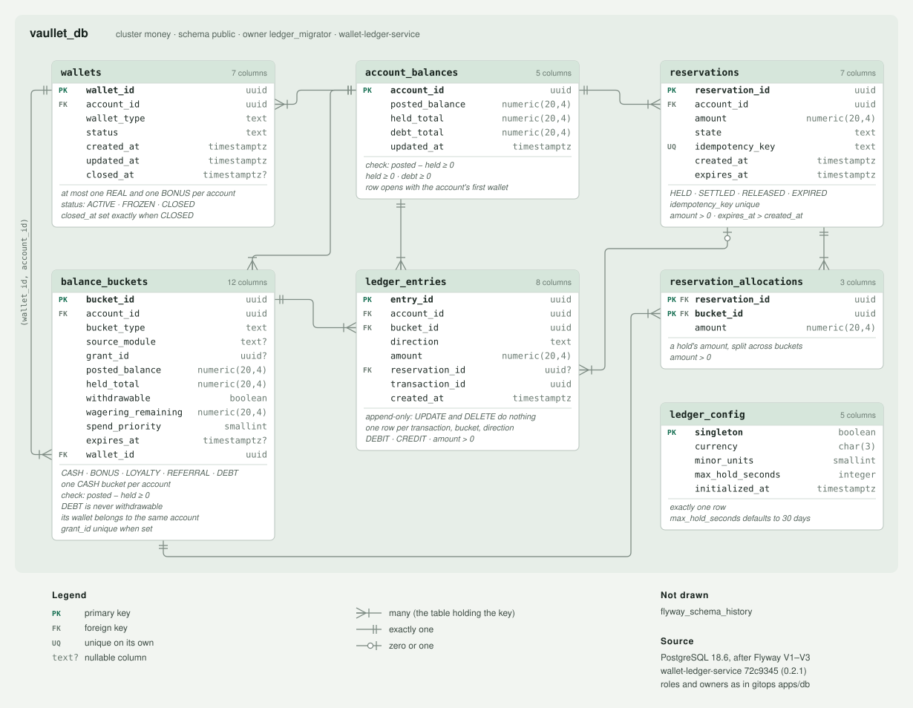

# `vaullet_db` — generated schema

> **Generated from a real database.** A throwaway PostgreSQL is migrated by Flyway from
> `src/main/resources/db/migration/`, then this page is written from `pg_catalog`. It therefore
> describes what the database *ended up with*, not what the DDL appears to say — including the
> indexes a `UNIQUE` constraint created, the system names that show up in error messages, and what
> each rule rewrites. Do not edit by hand.

Database `vaullet_db`, schema `public` · PostgreSQL **18.6** · Flyway **12.4.0**

| Migration | Description | Checksum |
| --- | --- | --- |
| `V1` | ledger | `775353396` |
| `V2` | wallets | `226851215` |
| `V3` | grant app role | `-1945421184` |

## `account_balances`

| | Column | Type | Null | Default |
| --- | --- | --- | --- | --- |
| `PK` | `account_id` | `uuid` | — |  |
|  | `posted_balance` | `numeric(20,4)` | — | `0` |
|  | `held_total` | `numeric(20,4)` | — | `0` |
|  | `debt_total` | `numeric(20,4)` | — | `0` |
|  | `updated_at` | `timestamp with time zone` | — | `now()` |

### Constraints

| Name | Kind | Definition |
| --- | --- | --- |
| `account_balances_debt_total_check` | CHECK | `CHECK ((debt_total >= (0)::numeric))` |
| `account_balances_held_total_check` | CHECK | `CHECK ((held_total >= (0)::numeric))` |
| `account_not_overdrawn` | CHECK | `CHECK (((posted_balance - held_total) >= (0)::numeric))` |
| `account_balances_pkey` | PRIMARY KEY | `PRIMARY KEY (account_id)` |

### Indexes

| Name | Definition |
| --- | --- |
| `account_balances_pkey` | `CREATE UNIQUE INDEX account_balances_pkey ON public.account_balances USING btree (account_id)` |

## `balance_buckets`

| | Column | Type | Null | Default |
| --- | --- | --- | --- | --- |
| `PK` | `bucket_id` | `uuid` | — |  |
| `FK` | `account_id` | `uuid` | — |  |
|  | `bucket_type` | `text` | — |  |
|  | `source_module` | `text` | **nullable** |  |
|  | `grant_id` | `uuid` | **nullable** |  |
|  | `posted_balance` | `numeric(20,4)` | — | `0` |
|  | `held_total` | `numeric(20,4)` | — | `0` |
|  | `withdrawable` | `boolean` | — |  |
|  | `wagering_remaining` | `numeric(20,4)` | — | `0` |
|  | `spend_priority` | `smallint` | — |  |
|  | `expires_at` | `timestamp with time zone` | **nullable** |  |
| `FK` | `wallet_id` | `uuid` | — |  |

### Constraints

| Name | Kind | Definition |
| --- | --- | --- |
| `balance_buckets_bucket_type_check` | CHECK | `CHECK ((bucket_type = ANY (ARRAY['CASH'::text, 'BONUS'::text, 'LOYALTY'::text, 'REFERRAL'::text, 'DEBT'::text])))` |
| `balance_buckets_held_total_check` | CHECK | `CHECK ((held_total >= (0)::numeric))` |
| `bucket_not_overdrawn` | CHECK | `CHECK (((posted_balance - held_total) >= (0)::numeric))` |
| `debt_never_withdrawable` | CHECK | `CHECK (((bucket_type <> 'DEBT'::text) OR (withdrawable = false)))` |
| `balance_buckets_account_id_fkey` | FOREIGN KEY | `FOREIGN KEY (account_id) REFERENCES account_balances(account_id)` |
| `balance_buckets_wallet_fk` | FOREIGN KEY | `FOREIGN KEY (wallet_id, account_id) REFERENCES wallets(wallet_id, account_id)` |
| `balance_buckets_pkey` | PRIMARY KEY | `PRIMARY KEY (bucket_id)` |

### Indexes

| Name | Definition |
| --- | --- |
| `balance_buckets_alloc_ix` | `CREATE INDEX balance_buckets_alloc_ix ON public.balance_buckets USING btree (account_id, spend_priority)` |
| `balance_buckets_grant_uk` | `CREATE UNIQUE INDEX balance_buckets_grant_uk ON public.balance_buckets USING btree (grant_id) WHERE (grant_id IS NOT NULL)` |
| `balance_buckets_one_cash` | `CREATE UNIQUE INDEX balance_buckets_one_cash ON public.balance_buckets USING btree (account_id) WHERE (bucket_type = 'CASH'::text)` |
| `balance_buckets_pkey` | `CREATE UNIQUE INDEX balance_buckets_pkey ON public.balance_buckets USING btree (bucket_id)` |
| `balance_buckets_wallet_ix` | `CREATE INDEX balance_buckets_wallet_ix ON public.balance_buckets USING btree (wallet_id)` |

## `ledger_config`

| | Column | Type | Null | Default |
| --- | --- | --- | --- | --- |
| `PK` | `singleton` | `boolean` | — | `true` |
|  | `currency` | `character(3)` | — |  |
|  | `minor_units` | `smallint` | — |  |
|  | `max_hold_seconds` | `integer` | — | `2592000` |
|  | `initialized_at` | `timestamp with time zone` | — | `now()` |

### Constraints

| Name | Kind | Definition |
| --- | --- | --- |
| `ledger_config_singleton_check` | CHECK | `CHECK (singleton)` |
| `ledger_config_pkey` | PRIMARY KEY | `PRIMARY KEY (singleton)` |

### Indexes

| Name | Definition |
| --- | --- |
| `ledger_config_pkey` | `CREATE UNIQUE INDEX ledger_config_pkey ON public.ledger_config USING btree (singleton)` |

## `ledger_entries`

| | Column | Type | Null | Default |
| --- | --- | --- | --- | --- |
| `PK` | `entry_id` | `uuid` | — |  |
| `FK` | `account_id` | `uuid` | — |  |
| `FK` | `bucket_id` | `uuid` | — |  |
|  | `direction` | `text` | — |  |
|  | `amount` | `numeric(20,4)` | — |  |
| `FK` | `reservation_id` | `uuid` | **nullable** |  |
|  | `transaction_id` | `uuid` | — |  |
|  | `created_at` | `timestamp with time zone` | — | `now()` |

### Constraints

| Name | Kind | Definition |
| --- | --- | --- |
| `ledger_entries_amount_check` | CHECK | `CHECK ((amount > (0)::numeric))` |
| `ledger_entries_direction_check` | CHECK | `CHECK ((direction = ANY (ARRAY['DEBIT'::text, 'CREDIT'::text])))` |
| `ledger_entries_account_id_fkey` | FOREIGN KEY | `FOREIGN KEY (account_id) REFERENCES account_balances(account_id)` |
| `ledger_entries_bucket_id_fkey` | FOREIGN KEY | `FOREIGN KEY (bucket_id) REFERENCES balance_buckets(bucket_id)` |
| `ledger_entries_reservation_id_fkey` | FOREIGN KEY | `FOREIGN KEY (reservation_id) REFERENCES reservations(reservation_id)` |
| `ledger_entries_pkey` | PRIMARY KEY | `PRIMARY KEY (entry_id)` |

### Indexes

| Name | Definition |
| --- | --- |
| `ledger_entries_pkey` | `CREATE UNIQUE INDEX ledger_entries_pkey ON public.ledger_entries USING btree (entry_id)` |
| `ledger_entries_txn_uk` | `CREATE UNIQUE INDEX ledger_entries_txn_uk ON public.ledger_entries USING btree (transaction_id, bucket_id, direction)` |

### Rules

- **`ledger_entries_no_delete`** — `CREATE RULE ledger_entries_no_delete AS ON DELETE TO public.ledger_entries DO INSTEAD NOTHING;`
  A `DELETE` from `ledger_entries` is rewritten into nothing: it succeeds, reports `DELETE 0` and removes no row. That holds for every role: the owner, and a role without the `DELETE` privilege, which gets no error.
- **`ledger_entries_no_update`** — `CREATE RULE ledger_entries_no_update AS ON UPDATE TO public.ledger_entries DO INSTEAD NOTHING;`
  An `UPDATE` of `ledger_entries` is rewritten into nothing: it succeeds, reports `UPDATE 0` and changes no row. That holds for every role: the owner, and a role without the `UPDATE` privilege, which gets no error.

Rules do not see `TRUNCATE`; only the privilege stops it.

## `reservation_allocations`

| | Column | Type | Null | Default |
| --- | --- | --- | --- | --- |
| `PK` `FK` | `reservation_id` | `uuid` | — |  |
| `PK` `FK` | `bucket_id` | `uuid` | — |  |
|  | `amount` | `numeric(20,4)` | — |  |

### Constraints

| Name | Kind | Definition |
| --- | --- | --- |
| `reservation_allocations_amount_check` | CHECK | `CHECK ((amount > (0)::numeric))` |
| `reservation_allocations_bucket_id_fkey` | FOREIGN KEY | `FOREIGN KEY (bucket_id) REFERENCES balance_buckets(bucket_id)` |
| `reservation_allocations_reservation_id_fkey` | FOREIGN KEY | `FOREIGN KEY (reservation_id) REFERENCES reservations(reservation_id)` |
| `reservation_allocations_pkey` | PRIMARY KEY | `PRIMARY KEY (reservation_id, bucket_id)` |

### Indexes

| Name | Definition |
| --- | --- |
| `reservation_allocations_pkey` | `CREATE UNIQUE INDEX reservation_allocations_pkey ON public.reservation_allocations USING btree (reservation_id, bucket_id)` |

## `reservations`

| | Column | Type | Null | Default |
| --- | --- | --- | --- | --- |
| `PK` | `reservation_id` | `uuid` | — |  |
| `FK` | `account_id` | `uuid` | — |  |
|  | `amount` | `numeric(20,4)` | — |  |
|  | `state` | `text` | — |  |
| `UK` | `idempotency_key` | `text` | — |  |
|  | `created_at` | `timestamp with time zone` | — | `now()` |
|  | `expires_at` | `timestamp with time zone` | — |  |

### Constraints

| Name | Kind | Definition |
| --- | --- | --- |
| `reservation_expiry_after_creation` | CHECK | `CHECK ((expires_at > created_at))` |
| `reservations_amount_check` | CHECK | `CHECK ((amount > (0)::numeric))` |
| `reservations_state_check` | CHECK | `CHECK ((state = ANY (ARRAY['HELD'::text, 'SETTLED'::text, 'RELEASED'::text, 'EXPIRED'::text])))` |
| `reservations_account_id_fkey` | FOREIGN KEY | `FOREIGN KEY (account_id) REFERENCES account_balances(account_id)` |
| `reservations_pkey` | PRIMARY KEY | `PRIMARY KEY (reservation_id)` |
| `reservations_idempotency_uk` | UNIQUE | `UNIQUE (idempotency_key)` |

### Indexes

| Name | Definition |
| --- | --- |
| `reservations_idempotency_uk` | `CREATE UNIQUE INDEX reservations_idempotency_uk ON public.reservations USING btree (idempotency_key)` |
| `reservations_pkey` | `CREATE UNIQUE INDEX reservations_pkey ON public.reservations USING btree (reservation_id)` |
| `reservations_sweep_ix` | `CREATE INDEX reservations_sweep_ix ON public.reservations USING btree (state, expires_at) WHERE (state = 'HELD'::text)` |

## `wallets`

| | Column | Type | Null | Default |
| --- | --- | --- | --- | --- |
| `PK` | `wallet_id` | `uuid` | — |  |
| `FK` | `account_id` | `uuid` | — |  |
|  | `wallet_type` | `text` | — |  |
|  | `status` | `text` | — | `'ACTIVE'::text` |
|  | `created_at` | `timestamp with time zone` | — | `now()` |
|  | `updated_at` | `timestamp with time zone` | — | `now()` |
|  | `closed_at` | `timestamp with time zone` | **nullable** |  |

### Constraints

| Name | Kind | Definition |
| --- | --- | --- |
| `wallets_closed_at_iff_closed` | CHECK | `CHECK (((status = 'CLOSED'::text) = (closed_at IS NOT NULL)))` |
| `wallets_status_check` | CHECK | `CHECK ((status = ANY (ARRAY['ACTIVE'::text, 'FROZEN'::text, 'CLOSED'::text])))` |
| `wallets_wallet_type_check` | CHECK | `CHECK ((wallet_type = ANY (ARRAY['REAL'::text, 'BONUS'::text])))` |
| `wallets_account_id_fkey` | FOREIGN KEY | `FOREIGN KEY (account_id) REFERENCES account_balances(account_id)` |
| `wallets_pkey` | PRIMARY KEY | `PRIMARY KEY (wallet_id)` |
| `wallets_of_account` | UNIQUE | `UNIQUE (wallet_id, account_id)` |
| `wallets_one_per_type` | UNIQUE | `UNIQUE (account_id, wallet_type)` |

### Indexes

| Name | Definition |
| --- | --- |
| `wallets_keyset_ix` | `CREATE INDEX wallets_keyset_ix ON public.wallets USING btree (created_at, wallet_id)` |
| `wallets_of_account` | `CREATE UNIQUE INDEX wallets_of_account ON public.wallets USING btree (wallet_id, account_id)` |
| `wallets_one_per_type` | `CREATE UNIQUE INDEX wallets_one_per_type ON public.wallets USING btree (account_id, wallet_type)` |
| `wallets_pkey` | `CREATE UNIQUE INDEX wallets_pkey ON public.wallets USING btree (wallet_id)` |
| `wallets_status_keyset_ix` | `CREATE INDEX wallets_status_keyset_ix ON public.wallets USING btree (status, created_at, wallet_id)` |

## Privileges

An owner holds every privilege on what it owns. The other columns are what has been granted to
other roles, as the access control lists record it.

| Object | Owner | `ledger_app` | `PUBLIC` |
| --- | --- | --- | --- |
| schema `public` | `pg_database_owner` | `USAGE` | `USAGE` |
| `account_balances` | `ledger_migrator` | `SELECT`, `INSERT`, `UPDATE` | — |
| `balance_buckets` | `ledger_migrator` | `SELECT`, `INSERT`, `UPDATE` | — |
| `flyway_schema_history` | `ledger_migrator` | — | — |
| `ledger_config` | `ledger_migrator` | `SELECT` | — |
| `ledger_entries` | `ledger_migrator` | `SELECT`, `INSERT` | — |
| `reservation_allocations` | `ledger_migrator` | `SELECT`, `INSERT` | — |
| `reservations` | `ledger_migrator` | `SELECT`, `INSERT`, `UPDATE` | — |
| `wallets` | `ledger_migrator` | `SELECT`, `INSERT`, `UPDATE` | — |

### Default privileges

What a role's *future* objects are granted as they are created, without a `GRANT` of their own:

| Created by | In schema | Objects | Granted to | Privileges |
| --- | --- | --- | --- | --- |
| `ledger_migrator` | `public` | sequences | `ledger_app` | `SELECT`, `USAGE` |
| `ledger_migrator` | `public` | tables | `ledger_app` | `SELECT`, `INSERT` |

## Diagram

<picture>
  <source media="(prefers-color-scheme: dark)" srcset="erd-dark.svg">
  
</picture>

## Other objects

| Kind | Name |
| --- | --- |
| table (Flyway-owned) | `flyway_schema_history` |

Full DDL as the database reports it: [`schema.sql`](schema.sql). Machine-readable catalog: [`schema.json`](schema.json).
